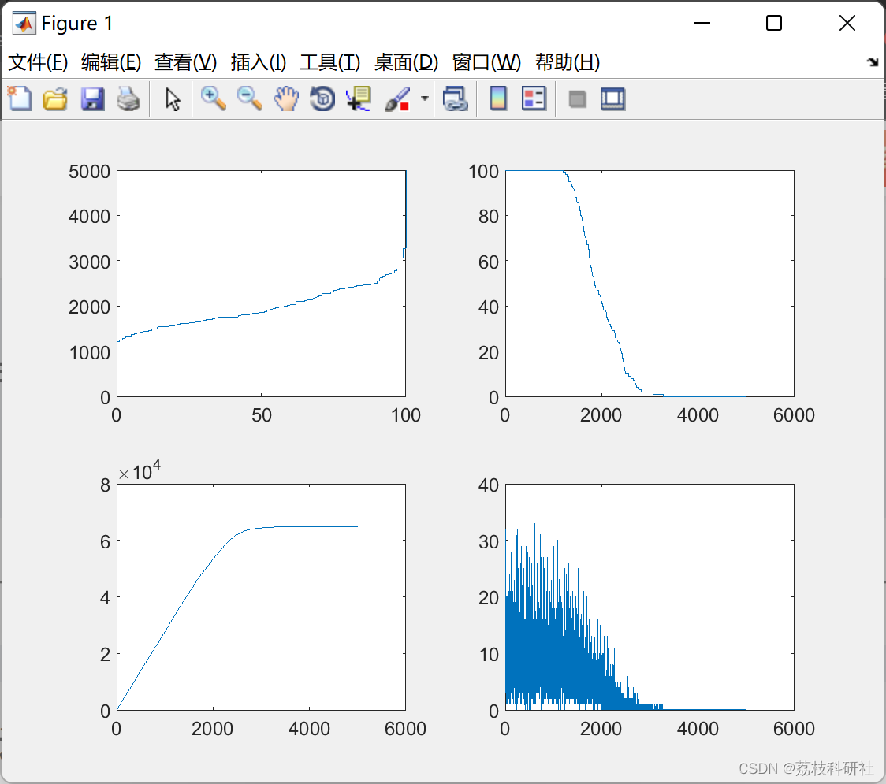

# Distributed Energy Savings Clustering Algorithm (Matlab Code Implementation)

📚2 Running Results Editing
Part of the code:
d1=0.765*xm/2; %distance between cluster head and base station
K=sqrt(0.5*n*do/pi)*xm/d1^2; %optimal number of cluster heads
d2=xm/sqrt(2*pi*K); %distance between cluster members and cluster head
Er=4000*(2*n*ETX+n*EDA+K*Emp*d1^4+n*Efs*d2^2); %energy dissipated in a round
S(n+1).xd=sink.x; %sink is a n+1 node, x-axis position of a node
S(n+1).yd=sink.y; %sink is a n+1 node, y-axis position of a node
countCHs=0; %variable, counts the cluster head
cluster=1; %cluster is initialized as 1
flag_first_dead=0; %flag tells the first node dead
flag_teenth_dead=0; %flag tells the 10th node dead
flag_all_dead=0; %flag tells all nodes dead
dead=0; %dead nodes count initialized to 0  
first_dead=0;  
teenth_dead=0;  
all_dead=0;  
allive=n;  
%counter for bit transmitted to Bases Station and to Cluster Heads  
packets_TO_BS=0;  
packets_TO_CH=0;  
for r=0:1:rmax  
r  
if(mod(r, round(1/P) )==0)  
for i=1:1:n  
S(i).G=0;  
S(i).cl=0;  
end  
end  
Ea=Et*(1-r/rmax)/n;  
dead=0;  
for i=1:1:n  
if (S(i).E<=0)  
dead=dead+1;  
if (dead==1)  
if(flag_first_dead==0)  
first_dead=r;  
flag_first_dead=1;  
end  
end  
if(dead==0.1*n)  
if(flag_teenth_dead==0)  
teenth_dead=r;  
flag_teenth_dead=1;  
end  
end  
if(dead==n)  
if(flag_all_dead==0)  
all_dead=r;  
flag_all_dead=1;  
end  
end  
end  
if S(i).E>0  
S(i).type='N';  
end  
end  
STATISTICS.DEAD(r+1)=dead;  
STATISTICS.ALLIVE(r+1)=allive-dead;  
countCHs=0;  
cluster=1;  
for i=1:1:n  
if Ea>0  
p(i)=P*n*(1+a)*E(i)/(n+A)*(Ea);  
%p(i)=P*n*S(i).E*E(i)/(Et*Ea);  
if(S(i).E>0)  
temp_rand=rand;  
if ( (S(i).G)<=0)  
if(temp_rand<= (p(i)/(1-p(i)*mod(r,round(1/p(i))))))  
countCHs=countCHs+1;  
packets_TO_BS=packets_TO_BS+1;  
PACKETS_TO_BS(r+1)=packets_TO_BS;  
S(i).type='C';  
S(i).G=round(1/p(i))-1;  
C(cluster).xd=S(i).xd;  
C(cluster).yd=S(i).yd;  
distance=sqrt( (S(i).xd-(S(n+1).xd) )^2 + (S(i).yd-(S(n+1).yd) )^2 );  
C(cluster).distance=distance;  
C(cluster).id=i;  
X(cluster)=S(i).xd;  
Y(cluster)=S(i).yd;  
cluster=cluster+1;  
distance;  
if (distance>do)  
S(i).E=S(i).E- ( (ETX+EDA)*(4000) + Emp*4000*( distance*distance*distance*distance ));  
end  
if (distance<=do)  
S(i).E=S(i).E- ( (ETX+EDA)*(4000) + Efs*4000*( distance * distance ));  
end  
end  
end  
end  
end  
end  
STATISTICS.COUNTCHS(r+1)=countCHs;  
%(5) Selection of cluster members to form the cluster head module (i.e., the formation module of the cluster).
% Cluster member selection for the cluster head (i.e., cluster formation) algorithm
for i=1:1:n  
if ( S(i).type=='N' && S(i).E>0 )  
if(cluster-1>=1)  
min_dis=sqrt( (S(i).xd-S(n+1).xd)^2 + (S(i).yd-S(n+1).yd)^2 );  
min_dis_cluster=0;  
for c=1:1:cluster-1  
temp=min(min_dis,sqrt( (S(i).xd-C(c).xd)^2 + (S(i).yd-C(c).yd)^2 ) );  
if ( temp<min_dis )  
min_dis=temp;  
min_dis_cluster=c;  
end  
end  
% Energy consumption of nodes within the cluster (sending 4000 bits of data)
if(min_dis_cluster~=0)  
min_dis;  
if (min_dis>do)  
S(i).E=S(i).E- ( ETX*(4000) + Emp*4000*( min_dis * min_dis * min_dis * min_dis));  
end  
if (min_dis<=do)  
S(i).E=S(i).E- ( ETX*(4000) + Efs*4000*( min_dis * min_dis));  
end  
S(C(min_dis_cluster).id).E = S(C(min_dis_cluster).id).E- ( (ERX + EDA)*4000 );  
packets_TO_CH=packets_TO_CH+1;  
else  
min_dis;  
if (min_dis>do)  
S(i).E=S(i).E- ( ETX*(4000) + Emp*4000*( min_dis * min_dis * min_dis * min_dis));  
end  
if (min_dis<=do)  
S(i).E=S(i).E- ( ETX*(4000) + Efs*4000*( min_dis * min_dis));  
end  
packets_TO_BS=packets_TO_BS+1;  
end  
S(i).min_dis=min_dis;  
S(i).min_dis_cluster=min_dis_cluster;  
else  
min_dis=sqrt( (S(i).xd-S(n+1).xd)^2 + (S(i).yd-S(n+1).yd)^2 );  
if (min_dis>do)  
S(i).E=S(i).E- ( ETX*(4000) + Emp*4000*( min_dis * min_dis * min_dis * min_dis));  
end  
if (min_dis<=do)  
S(i).E=S(i).E- ( ETX*(4000) + Efs*4000*( min_dis * min_dis));  
end  
packets_TO_BS=packets_TO_BS+1;  
end  
end  
end  
STATISTICS.PACKETS_TO_CH(r+1)=packets_TO_CH;  
STATISTICS.PACKETS_TO_BS(r+1)=packets_TO_BS;  
end  
first_dead  
teenth_dead  
all_dead  
STATISTICS.DEAD(r+1)  
STATISTICS.ALLIVE(r+1)  
STATISTICS.PACKETS_TO_CH(r+1)  
STATISTICS.PACKETS_TO_BS(r+1)  
STATISTICS.COUNTCHS(r+1)  
r=0:5000;  
subplot(2,2,1);  
plot(STATISTICS.DEAD,r);  
subplot(2,2,2);  
plot(r,STATISTICS.ALLIVE);  
subplot(2,2,3);  
plot(r,STATISTICS.PACKETS_TO_BS);  
subplot(2,2,4);  
plot(r,STATISTICS.COUNTCHS);  
🎉3 References  
🌈4 Matlab code implementation

## Images

<!-- PAYMENT_BLOCK -->

## Get this dataset

- Payment link (Stripe): [Buy now](https://buy.stripe.com/3cs8yP7sY87d0vu9AB)
- Payment QR code: 

<!-- /PAYMENT_BLOCK -->
